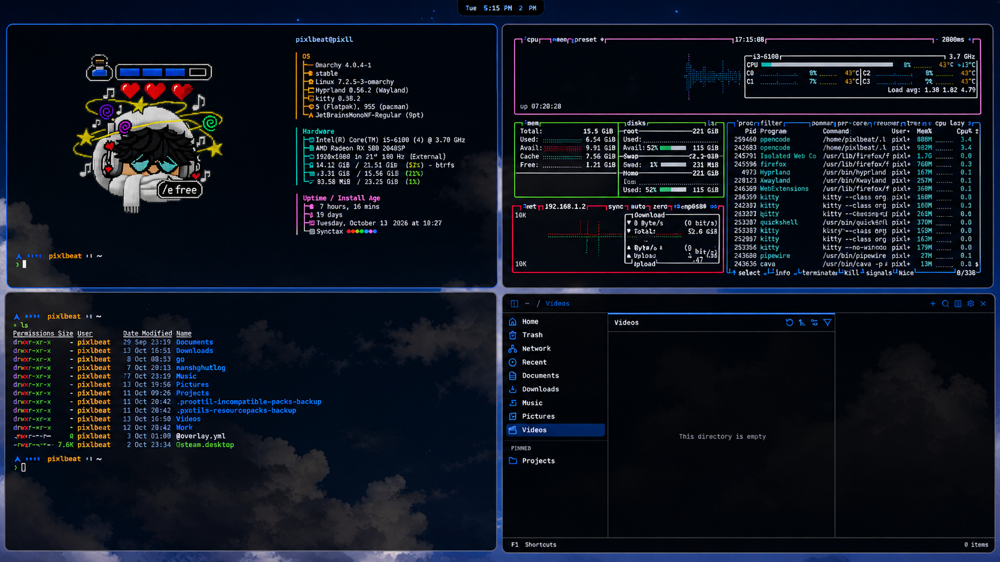

<div align="center">

# Synctax

**A refined true-black Omarchy theme with an electric blue accent, muted selection highlights, and curated 4K wallpapers.**

[](https://github.com/pxllbt/synctax/actions)
[](https://omarchy.org/themes)
[](#-overview)
[](LICENSE)
[](https://github.com/pxllbt/synctax/pulls)

<br/>



<br/>

*Pitch-Black Depth · Electric Blue Accent · Studio Quality Typography*

[Overview](#-overview) • [Preview](#-preview) • [Features](#-features) • [Installation](#-installation) • [Palette](#-color-palette) • [Wallpapers](#-curated-wallpapers) • [Contributing](#-contributing)

</div>

---

## 🌟 Overview

**Synctax** is an official desktop theme for [Omarchy](https://omarchy.org), engineered around an uncompromising `#000000` pitch-black foundation. 

Instead of washed-out charcoal or muddy greys, Synctax delivers true OLED black surfaces with four distinct elevation depths, a carefully calibrated near-white text luminance hierarchy, and a single electric blue accent (`#1e66f5`) across active window borders, focus rings, and focal UI elements. Text selections and highlights use the muted palette tone (`#acb0be`) for clean contrast against the deep black background. Eight high-contrast semantic accent colors provide immediate clarity for syntax highlighting, warnings, errors, and system status.

---

## ✨ Features

- **True Pitch-Black Foundation**: Built on pure `#000000` black canvas with 4 subtle surface depths for cards, dialogs, and elevated controls.
- **Unified Electric Accent**: Single electric blue (`#1e66f5`) accent color for active window borders, focus rings, and focal UI elements.
- **Muted Selection Highlights**: Text selections use the soft gray palette tone (`#acb0be`) for clean contrast on the black foundation.
- **Measured Text Hierarchy**: 4-step near-white luminance scale (`#e6e9f0`, `#cdd6f4`, `#bcc0cc`, `#9ca0b0`) tested for comfortable, eye-strain-free reading on black.
- **Hyprland Aligned**: Active window borders glow with `rgba(1e66f5ee)` matching status bar and terminal highlights.
- **Curated 4K Wallpaper Pack**: Ships with three backgrounds designed to harmonize with the theme palette (`omarchy theme bg next`).
- **Comprehensive App Theming**: Universal theme sync across Hyprland, Better Bar, Waybar, GTK3/4, Qt5/6, Foot, Kitty, Alacritty, Ghostty, Neovim, and VSCode.

---

## 📦 Installation

Install directly using the Omarchy theme manager:

```bash
omarchy theme install https://github.com/pxllbt/synctax
omarchy theme set synctax
```

Or open the Omarchy menu (`Super + Ctrl + Shift + Space`):
1. Navigate to **Install** > **Style** > **Theme**
2. Select **Synctax** to activate instantly with zero latency.

*Requires Omarchy 4.x for semantic palette support.*

---

## 🎨 Color Palette

| Key | Swatch | Value | Role & Description |
| :--- | :---: | :--- | :--- |
| `background` |  | `#000000` | Pure Black (base canvas, root desktop) |
| `dark_background` |  | `#090909` | Surface (cards, sidebars, panes) |
| `darker_background` |  | `#070707` | Deep Surface (insets, gutters, troughs) |
| `lighter_background` |  | `#1a1a1a` | Raised Surface (hover tiles, elevated dialogs) |
| `foreground` |  | `#cdd6f4` | Primary Text (standard body copy) |
| `bright_foreground` |  | `#e6e9f0` | High Emphasis (headings, active window titles) |
| `light_foreground` |  | `#bcc0cc` | Medium Emphasis (secondary text, labels) |
| `dark_foreground` |  | `#9ca0b0` | Low Emphasis (subtext, line numbers, hints) |
| `accent` |  | `#1e66f5` | Electric Blue (active borders, focus rings) |
| `selection` |  | `#acb0be` | Text Selection & Active Highlights |
| `muted` |  | `#acb0be` | Overlay & Inactive Borders |
| `red` |  | `#d20f39` | Coral Red (errors, critical badges) |
| `yellow` |  | `#df8e1d` | Warm Amber (warnings, attention alerts) |
| `orange` |  | `#d84e2b` | Deep Peach (special tokens, parameters) |
| `green` |  | `#40a02b` | Emerald Green (success states, additions) |
| `cyan` |  | `#179299` | Crisp Teal (types, constants, operators) |
| `blue` |  | `#1e66f5` | Electric Blue (hyperlinks, functions) |
| `magenta` |  | `#ea76cb` | Vibrant Pink (keywords, control flow) |
| `brown` |  | `#6c2715` | Muted Maroon (special identifiers) |

---

## 🖼️ Curated Wallpapers

Three custom high-resolution backgrounds ship with Synctax. Cycle between them in real time:

```bash
omarchy theme bg next
```

| Wallpaper | Resolution | Palette & Description |
| :--- | :---: | :--- |
| `backgrounds/gradient.jpg` | 5640 × 2400 | Ultra-wide dark blue gradient smoothly flowing from deep midnight to electric cyan. |
| `backgrounds/void.png` | 1920 × 1080 | Minimalist pitch-black surface with subtle monolithic geometric accents. |
| `backgrounds/nebula.png` | 1920 × 1080 | Cosmic deep-navy starfield with luminous blue gaseous highlights. |

---

## 🤝 Contributing

Contributions, color harmony suggestions, and new wallpapers are welcome! Please check our [Contributing Guidelines](CONTRIBUTING.md) and [Security Policy](SECURITY.md) before opening a pull request.

---

## 📄 License

Licensed under the [MIT License](LICENSE). Built with ❤️ by [pxllbt](https://github.com/pxllbt).
